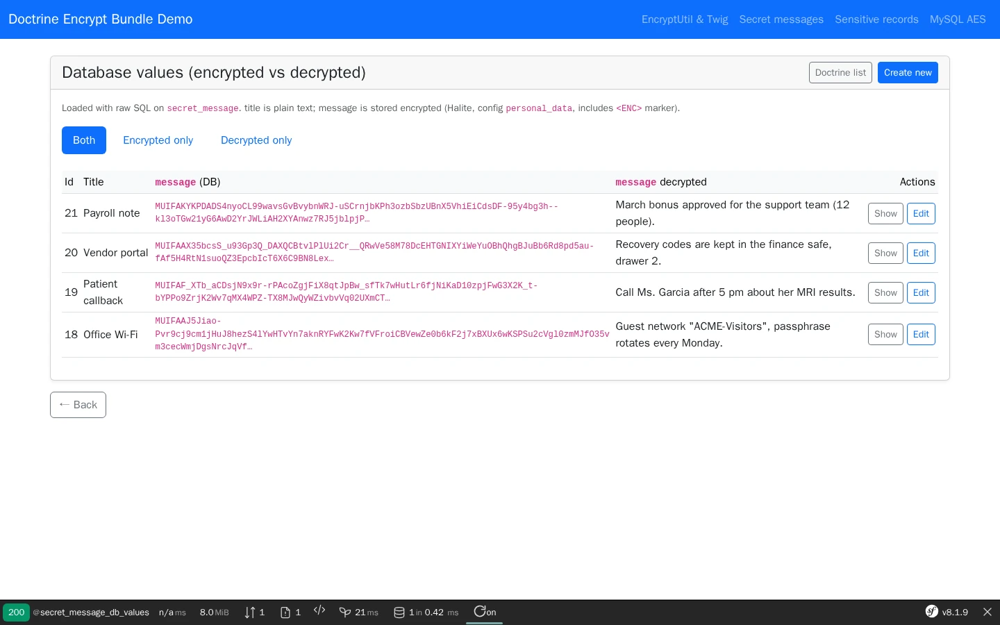
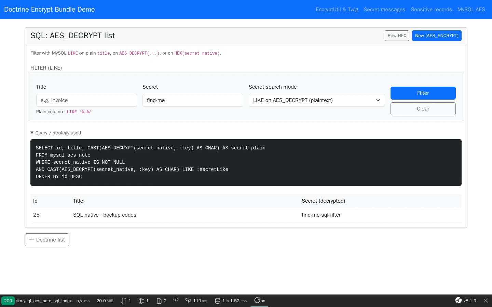

# Demo Projects

The bundle includes a **dockerized** demo project (**Symfony 8**). It runs on **FrankenPHP** with a custom **Caddyfile** and has its own **Makefile**.

## Table of contents

- [Screenshots](#screenshots)
- [Quick start (Docker)](#quick-start-docker)
- [Makefile targets](#makefile-targets)
- [Playwright e2e and screenshots](#playwright-e2e-and-screenshots)
- [FrankenPHP (runtime and worker mode)](#frankenphp-runtime-and-worker-mode)
- [What each demo includes](#what-each-demo-includes)
- [Multiple encryptors and EncryptUtil](#multiple-encryptors-and-encryptutil)
- [Troubleshooting: `composer update` and security advisories](#troubleshooting-composer-update-and-security-advisories)
- [Forms in Twig (REQ-TWIG-005)](#forms-in-twig-req-twig-005)

## Screenshots

Captured by Playwright (`make demo-screenshots`) from the running demo, with the Symfony web debug toolbar:





| Demo      | Path            | Default port | PHP | Notes |
|-----------|-----------------|--------------|-----|-------|
| Symfony 8 | `demo/symfony8/` | 8008         | 8.5 | FrankenPHP `1-php8.5-alpine`; **MysqlAes** demo (`/mysql-aes-note`) |

## Quick start (Docker)

From the **demo directory** (e.g. `demo/symfony8`):

```bash
make up        # Start FrankenPHP container
make install   # composer install (bundle from /var/doctrine-encrypt-bundle)
make setup     # install + DB create + schema + generate secret key
```

Then open **http://localhost:8008** (or the port shown by `make up`).

## Makefile targets

- **up** – Start containers (FrankenPHP HTTP on configured port).
- **down** – Stop containers.
- **build** – Rebuild image (no cache).
- **install** – `composer install` in container.
- **setup** – install + db create + schema update + secret key + fixtures.
- **shell** – Shell in PHP container.
- **logs** – Container logs.
- **db-create**, **db-schema**, **key**, **fixtures** – Database, encryption key, and sample data.
- **cache-clear**, **update-bundle**, **test** – Cache, bundle update, tests.

Change port: `PORT=9008 make up`.

## Playwright e2e and screenshots

REQ-DEMO-013: the specs live in `demo/symfony8/e2e/tests/` and run in the official Playwright Docker image (one worker) against the demo `PORT`.

- **test-e2e** – Starts the demo (`make up` waits for HTTP 200), then `demo.spec.ts`: home, decrypted list, create a secret message through the form, check the Halite ciphertext in the raw SQL view and the decrypted value in the Doctrine list, delete it again.
- **demo-screenshots** – Reloads the fixtures, then `screenshots.spec.ts` captures the full demo frame (navbar, bundle feature, web debug toolbar) as PNG and `scripts/to-webp.mjs` (`sharp`) writes `docs/images/demo/*.webp` and removes the PNGs.

Both targets are also available from the repository root (`make test-e2e`, `make demo-screenshots`); `make release-check` runs `test-e2e`.

## FrankenPHP (runtime and worker mode)

The demo runs with **FrankenPHP in worker mode** (boot once, handle requests in memory). The bundle is compatible with this setup: no request/session state, encryptors are stateless after loading the key, and the subscriber’s cache is cleared on `postFlush`. **No extra configuration or code** is required in the demo for FrankenPHP.

For production or long‑running workers, see the recommendations in [Installation → FrankenPHP](INSTALLATION.md#frankenphp-runtime-and-worker-mode) (e.g. limiting requests per worker when possible).

## What each demo includes

- **Dockerfile** – FrankenPHP (Alpine), extensions: zip, intl, sodium, pdo_sqlite, pdo_mysql; custom Caddyfile (the demo database is MySQL 8, service `db`).
- **docker/frankenphp/Caddyfile** – Root `/app/public`, worker `index.php` (2 workers), encoding (zstd, br, gzip).
- **docker-compose.yml** – Service `php`, volumes: demo dir + bundle root as `/var/doctrine-encrypt-bundle`.
- **Makefile** – Targets above.
- **public/index.php** – Symfony front controller.
- **config/** – Bundles (DoctrineEncryptBundle), Doctrine, `nowo_doctrine_encrypt.yaml`.
- **src/Entity/SecretMessage.php** – Example entity with `#[Encrypted]` property.
- **src/Entity/SensitiveRecord.php** – Entity with two profiles: `personal_data` and `financial_data`.
- **src/Controller/DemoController.php** – Home route.
- **src/Controller/EncryptUtilDemoController.php** – Page that uses **EncryptUtil**, **MaskUtil**, and the Twig filters **`|decrypt`** and **`|mask`**.
- **Templates** – CRUD for Secret messages and Sensitive records, plus the EncryptUtil & Twig demo page.

The bundle is installed via Composer **path repository** pointing to `/var/doctrine-encrypt-bundle` (mounted from the repo root). See **demo/README.md** for more detail.

## Multiple encryptors and EncryptUtil

The Symfony 8 demo uses **multiple encryptor profiles**. In `config/packages/nowo_doctrine_encrypt.yaml` you’ll find:

- **profiles:** e.g. `personal_data` (Halite), `financial_data` (Defuse), and optionally `env_var` (key from `%env(APP_ENCRYPT_KEY)%`), each with its own key or key file.
- **default_profile:** `personal_data` (used by `#[Encrypted]` without a profile name).

**SecretMessage** uses the default profile. **SensitiveRecord** uses both:

- `personal_note` → `#[Encrypted('personal_data')]`
- `financial_note` → `#[Encrypted('financial_data')]`

The **"EncryptUtil & Twig"** page demonstrates programmatic encrypt/decrypt via **EncryptUtil**, masking via **MaskUtil**, and the Twig filters **`|decrypt`** and **`|mask`** (default and config-specific usage). Run `make encrypt-status` (or `php bin/console doctrine:encrypt:status`) in the demo directory to see entities and encrypted properties. Full reference: [Configuration](CONFIGURATION.md#example-multiple-encryptors), [Usage](USAGE.md) (EncryptUtil, MaskUtil, Twig filters).

## Troubleshooting: `composer update` and security advisories

Composer **2.7+** can **block** packages with open security advisories.

The demo sets `config.audit.block-insecure: false` and `policy.advisories.block: false` so local `composer update` works; run `composer audit` to review advisories. Prefer **`make install`** / **`make update-bundle`** when you only need dependencies from the lock file.

If `composer update` still fails after pulling, run inside the container:

```bash
composer update -W --no-interaction
```

## Forms in Twig (REQ-TWIG-005)

Every UI form — bundle views and the demo apps — is a PHP Symfony Form Type (FormKit types when FormKit is in the stack) rendered with `form_start`, the REQ-TWIG-003 child loop and `form_end`; submit / cancel buttons may stay outside the loop:

```twig
{{ form_start(form) }}
    
        
            {{ form_row(child) }}
        
    
    <button type="submit">Save</button>
{{ form_end(form) }}
```

CSRF-only actions (delete, logout-style buttons, toggles) use an empty Form Type too, and login forms map `_username` / `_password` / `_csrf_token` (token id `authenticate`) on a Form Type. Host overrides and demos must not reintroduce raw `<form>` / `<input>` / `<textarea>` / `<select>` markup: `make check-no-raw-html-form` (part of `make release-check`) fails when it appears.
